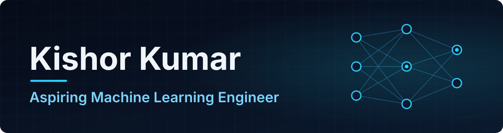

  

<h3 align="center">Artificial Intelligence | Machine Learning | Deep Learning | Building Practical AI Solutions</h3>

  Aspiring Machine Learning Engineer and BS Artificial Intelligence student at the University of Sindh, Jamshoro.

---

## About Me

I'm an Artificial Intelligence undergraduate working toward a career as a **Machine Learning Engineer**. I'm interested in how models move from notebooks into software people can actually use, so I'm building my foundations in **machine learning and deep learning** alongside **software engineering**.

- **Studying:** BS Artificial Intelligence, IMCS, University of Sindh (expected 2028)
- **Interests:** Machine Learning, Deep Learning, Computer Vision, Natural Language Processing
- **Goal:** building practical, well-tested AI applications

## Current Focus

| Area | What I'm learning |
| :--- | :--- |
| **Machine Learning** | Core algorithms, model development and evaluation |
| **Deep Learning** | Neural network fundamentals and architectures |
| **Computer Vision & NLP** | Applying ML to images and language |
| **Data Science** | Exploring, cleaning and analysing data with Python |
| **AI-powered Applications** | Turning trained models into usable software |

## Tech Stack

  

<!--
  Add ML libraries here once a public project uses them, for example:
  
-->

## Projects

**Machine learning projects are in progress** and will be added here as they're published.

| Project | About | Stack |
| :--- | :--- | :--- |
| [**Spendly**](https://github.com/2K24AI41/Spendly) | Software engineering project: a personal expense tracker with authentication, analytics, date filtering and a full pytest suite, built from written feature specs. | Python · Flask · SQLite · pytest |

## GitHub Activity

  

## Education

**Bachelor of Science in Artificial Intelligence**
Institute of Mathematics and Computer Science (IMCS), University of Sindh, Jamshoro
*Expected graduation: 2028*

## Connect With Me

I'm open to internships, collaborations and conversations about AI and machine learning.

<!-- PLACEHOLDER: replace YOUR-LINKEDIN-HANDLE below with your real LinkedIn profile handle before publishing -->

  
  &nbsp;
  

**Email:** [kishormenghwar4120@gmail.com](mailto:kishormenghwar4120@gmail.com) &nbsp;·&nbsp; **LinkedIn:** [YOUR-LINKEDIN-HANDLE](https://www.linkedin.com/in/YOUR-LINKEDIN-HANDLE/)
